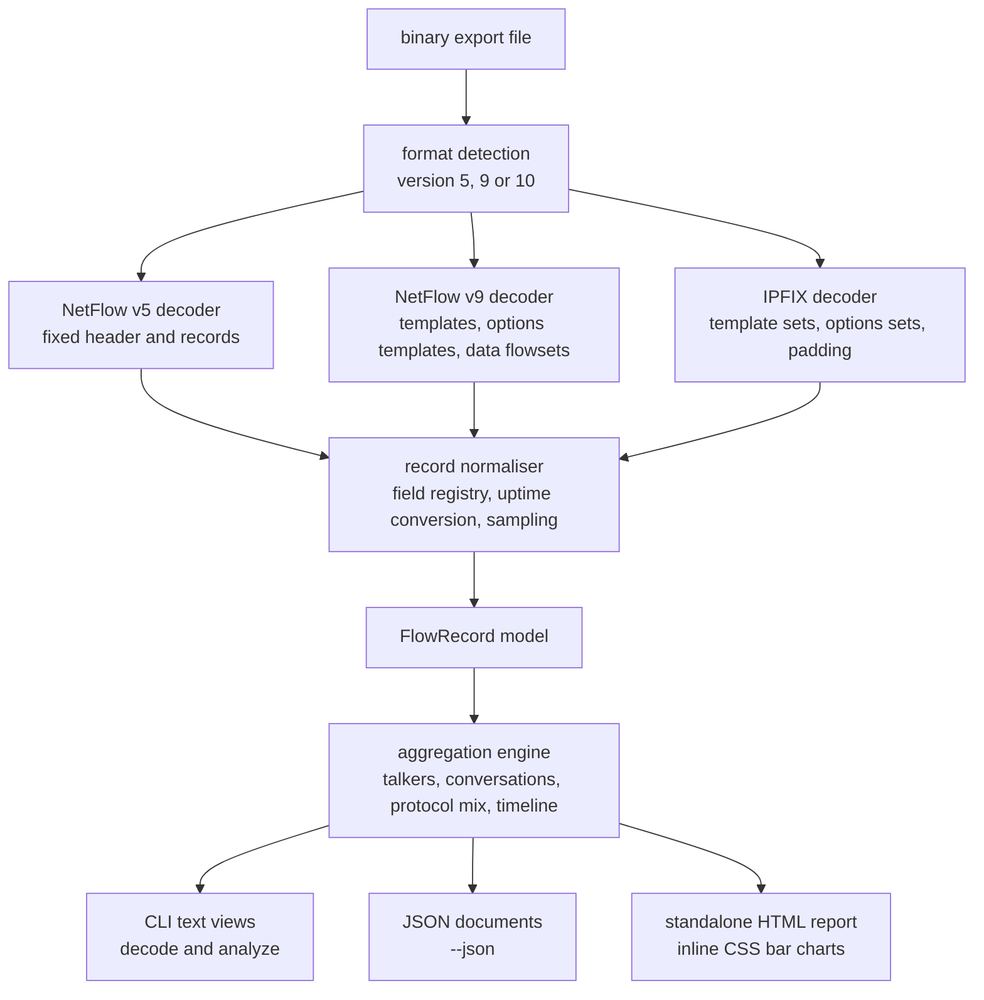

# flow-analyzer

Offline decoder and traffic analyst for NetFlow v5, NetFlow v9 and IPFIX exports, written in pure Python with no third-party runtime dependencies. It reads binary flow exports from routers and switches, normalises the records into one model, and reports top talkers, bidirectional conversations, protocol mix and a traffic timeline as text, JSON or a standalone HTML report.

[](https://github.com/jeremydacosta-TechOptimist/flow-analyzer/actions/workflows/ci.yml)
[](https://github.com/jeremydacosta-TechOptimist/flow-analyzer)
[](LICENSE)

## The problem it solves

Flow exports are compact and universal, but reading them usually means either a full collector stack that needs network access and a database, or a one-off decoder script that only understands one format and one version. Network administrators and students often just need to answer questions such as "who generated the most traffic in this export?" or "which conversations are in this capture?" without standing up a monitoring platform. `flow-analyzer` decodes the three common binary formats itself, normalises them into the same record shape, aggregates the traffic, and produces a report that can be attached to a ticket — all offline, with the standard library only.

## Features

- **NetFlow v5 decoder** for the fixed 24-byte header and 48-byte records, including engine type/id, sampling interval and `sysUpTime` to wall-clock conversion.
- **NetFlow v9 decoder** with template FlowSets, options template FlowSets, data FlowSets, template redefinition and `(source_id, template_id)` scoping; data that arrives before its template is skipped with a warning.
- **IPFIX decoder** (version 10) with template and options template sets, data sets, template withdrawal, enterprise bits, message/set padding and length validation.
- **Shared field registry** for the IANA field IDs used by both v9 and IPFIX (byte/packet counters, ports, addresses, AS numbers, masks, interface indexes, TCP flags, sampling, switching times), including IPv6 address fields and unknown fields kept as raw octets.
- **Sampling support**: counters are scaled by the sampling interval and the raw values stay available on every record, so reported numbers are never silently mixed.
- **Traffic analysis**: top talkers per source and destination, canonical bidirectional conversations (both directions merged, orientation-independent), protocol mix with service names for common ports, and a time-bucketed timeline.
- **Three output modes**: a `decode` view for debugging an export record by record, `--json` documents for automation, and a self-contained HTML report with inline CSS bar charts and no external assets or scripts.
- **Deterministic lab fixtures**: `examples/` ships small generated NetFlow v5, NetFlow v9 and IPFIX files, so tests and demos work offline without capturing live traffic.

The tool analyses complete export files. It is not a live collector, does not reassemble UDP datagrams, and does not resolve DNS names or geolocation; those are documented roadmap items rather than hidden behaviour.

## Quick start

```powershell
git clone https://github.com/jeremydacosta-TechOptimist/flow-analyzer.git
cd flow-analyzer
pip install -e .
flowanalyzer version
flowanalyzer generate --format v9 --out demo-flows.bin
```

```text
flowanalyzer 1.0.0
Wrote demo-flows.bin: 12 flow records, 776 B (NetFlow v9, seed 7)
```

The generated export models a small lab: `192.0.2.0/24` clients, servers in `198.51.100.0/24`, remote services in `203.0.113.0/24`, and IPv6 hosts under `2001:db8::/32`.

## Usage

### Decode an export record by record

```powershell
flowanalyzer decode examples/flows-v9.bin
```

```text
File: flows-v9.bin
Format: NetFlow v9 (version 9)
Header: sequence=42, export_time_ms=1768468200000, sys_uptime_ms=3600000, source_id=7, declared_count=12
Records: 12 record(s), 3 template(s), 0 warning(s)

    #  Start (UTC)               Duration  Proto  Endpoints                                                      Bytes  Packets
    1  2026-01-15 09:00:03.882 UTC     420 ms  TCP    192.0.2.10:49876 -> 198.51.100.10:80                           8,442       10
    2  2026-01-15 09:00:15.363 UTC    2.200 s  TCP    192.0.2.11:51422 -> 198.51.100.10:443                          8,688       12
    3  2026-01-15 09:00:24.237 UTC    2.200 s  UDP    192.0.2.12:53523 -> 198.51.100.20:53                             601        2
    4  2026-01-15 09:00:24.437 UTC    2.400 s  UDP    198.51.100.20:53 -> 192.0.2.12:53523                             300        1
    5  2026-01-15 09:00:49.776 UTC    1.500 s  TCP    192.0.2.10:51000 -> 198.51.100.40:22                           6,435       14
    6  2026-01-15 09:01:02.257 UTC    1.500 s  UDP    192.0.2.11:123 -> 198.51.100.50:123                              106        1
    7  2026-01-15 09:01:14.583 UTC    2.200 s  ICMP   192.0.2.30 -> 203.0.113.5                                        159        5
    8  2026-01-15 09:01:14.783 UTC    2.400 s  ICMP   203.0.113.5 -> 192.0.2.30                                         79        2
    9  2026-01-15 09:01:39.998 UTC     420 ms  TCP    [2001:db8::10]:52000 -> [2001:db8:100::10]:443                 7,443        9
   10  2026-01-15 09:01:49.716 UTC     420 ms  UDP    [2001:db8::11]:5353 -> [2001:db8::53]:53                         576        2
   11  2026-01-15 09:02:01.263 UTC    2.200 s  TCP    192.0.2.10:49876 -> 198.51.100.10:80                          12,709       15
   12  2026-01-15 09:02:01.463 UTC    2.400 s  TCP    198.51.100.10:80 -> 192.0.2.10:49876                           6,354        7
```

Use `--limit 0` to list every record and `--json` for structured output.

### Aggregate a capture

```powershell
flowanalyzer analyze examples/flows-ipfix.bin --top 3
```

```text
Source: flows-ipfix.bin (IPFIX v10)
Records: 12, bytes: 51,892, packets: 80, duration: 119.981 s
Time span: 2026-01-15 09:00:03.882 UTC to 2026-01-15 09:02:03.863 UTC
Average throughput: 3.5 kbit/s, 0.7 pkt/s
Exporters: flows-ipfix.bin

Top sources
Address                                        Bytes   Packets  Records
-----------------------------------------------------------------------
192.0.2.10                                    27,586        39        3
192.0.2.11                                     8,794        13        2
2001:db8::10                                   7,443         9        1

Top destinations
Address                                        Bytes   Packets  Records
-----------------------------------------------------------------------
198.51.100.10                                 29,839        37        3
2001:db8:100::10                               7,443         9        1
198.51.100.40                                  6,435        14        1

Top conversations
Protocol Service   Endpoint A                Endpoint B                      Bytes  Packets
---------------------------------------------------------------------------------------------
TCP      http      192.0.2.10:49876          198.51.100.10:80               27,505       32
TCP      https     192.0.2.11:51422          198.51.100.10:443               8,688       12
TCP      https     [2001:db8:100::10]:443    [2001:db8::10]:52000            7,443        9

Protocol mix
Protocol             Bytes  Records
-----------------------------------
TCP                 50,071        6
UDP                  1,583        4
ICMP                   238        2

Timeline (60 s buckets)
Bucket start (UTC)               Bytes   Packets  Records
---------------------------------------------------------
2026-01-15 09:00:03.882 UTC      24,572        40        6
2026-01-15 09:01:03.882 UTC      27,320        40        6
```

`--top` limits every table, `--bucket SECONDS` changes the timeline granularity, and `--json` returns the same analysis as a structured document.

### Produce a standalone HTML report

```powershell
flowanalyzer report examples/flows-v9.bin --out report.html
```

```text
Wrote HTML report to report.html (12 records, 8 conversations, 12.6 KiB)
```

The report contains summary cards, CSS bar charts for sources, destinations, protocol mix and timeline, and tables for conversations and decoder notes. It is a single file with inline styles: no JavaScript, no external assets and no network access.

## Architecture



The reader detects the format from the first two bytes and hands the bytes to the matching decoder. Each decoder parses its own headers, templates and record boundaries, reporting recoverable problems as warnings instead of discarding the whole export. Every decoded record passes through one normaliser that maps field IDs to names, converts switching-time fields into epoch milliseconds, resolves sampling and produces a version-independent `FlowRecord`. The aggregation layer groups records by source, destination, canonical 5-tuple conversation, protocol and time bucket, so the text, JSON and HTML renderers all share exactly the same numbers. Every layer is covered by unit tests against handcrafted byte buffers, which keeps the decoders independent from the generator.

## Project layout

```text
flow-analyzer/
├── .github/workflows/ci.yml
├── .gitignore
├── LICENSE
├── README.md
├── pyproject.toml
├── examples/
│   ├── README.md
│   ├── flows-v5.bin          # 12-record NetFlow v5 demo export
│   ├── flows-v9.bin          # 12-record NetFlow v9 demo export
│   └── flows-ipfix.bin       # 12-record IPFIX demo export
├── src/flowanalyzer/
│   ├── __init__.py           # public API
│   ├── __main__.py           # python -m flowanalyzer
│   ├── aggregate.py          # talkers, conversations, protocols, timeline
│   ├── cli.py                # generate / decode / analyze / report / version
│   ├── errors.py             # FlowError
│   ├── generate.py           # deterministic synthetic exporters
│   ├── model.py              # FlowRecord, FlowExport, record normaliser
│   ├── report.py             # HTML and text renderers
│   ├── sampling.py           # sampling helpers
│   ├── version.py
│   └── netflow/
│       ├── __init__.py
│       ├── fields.py         # IANA field registry and value codecs
│       ├── ipfix.py          # IPFIX v10 decoder
│       ├── reader.py         # format detection and unified reading
│       ├── template.py       # shared template structures and record decoder
│       ├── v5.py             # NetFlow v5 decoder
│       └── v9.py             # NetFlow v9 decoder
└── tests/
    ├── support.py            # handcrafted NetFlow/IPFIX fixtures
    ├── test_aggregate.py
    ├── test_cli.py
    ├── test_fields.py
    ├── test_generate.py
    ├── test_ipfix.py
    ├── test_model_sampling.py
    ├── test_reader.py
    ├── test_report.py
    ├── test_template.py
    ├── test_v5.py
    └── test_v9.py
```

## Testing

The suite uses `unittest.TestCase` classes, so it runs under both pytest and the standard library runner. Fixtures are built with `struct`, temporary files use `tempfile`, and no test needs network access.

```powershell
# from the repository root
$env:PYTHONPATH = "src"
py -3.13 -m pytest -q
python -m unittest discover -s tests
python -m compileall -q src tests
```

237 tests with 657 assertions cover:

- header and record decoding for NetFlow v5, including count mismatches, trailing bytes and truncation warnings;
- NetFlow v9 template lifecycle, template redefinition, options templates, sampling, IPv6 templates and data-before-template handling;
- IPFIX sets, template withdrawal, enterprise fields, padding, length validation and options-based sampling;
- the field registry and every value codec, including NTP timestamps and unknown fields;
- record normalisation, uptime conversion, sampling math and the model serialisation;
- talker ordering and tie-breaks, bidirectional conversation merging in both orientations, service names, protocol mix, time bucketing and summary rates;
- deterministic generation and generate → decode → analyze round trips for all three formats;
- HTML report sections, escaping and no external assets, plus the text renderer;
- the CLI in-process: generate, decode, analyze, report and version, with exit codes 0, 1 and 2.

## Roadmap

- Add a live UDP collector mode that keeps the NetFlow v9/IPFIX template cache across datagrams instead of treating each export file independently.
- Stream records to JSON Lines and CSV for larger exports instead of building the full analysis in memory.
- Render IPFIX enterprise-specific fields through an optional JSON field map, so vendor fields can be labelled without changing the code.

## Resumo em português (PT-PT)

- Descodificador e analisador de exportações NetFlow v5, NetFlow v9 e IPFIX em Python puro, sem dependências externas, pensado para análise offline de tráfego.
- Lê ficheiros binários de exportação, valida cabeçalhos, modelos e conjuntos de dados, e trata erros recuperáveis como avisos em vez de descartar a exportação inteira.
- Normaliza os registos para um modelo comum, aplica amostragem, e calcula principais emissores e destinatários, conversas bidirecionais, distribuição de protocolos e linha temporal por intervalos.
- Produz saída de texto, documentos JSON e um relatório HTML autónomo com gráficos de barras em CSS incorporado, sem ativos externos.
- Inclui um gerador determinístico de exportações de laboratório e testes executáveis com unittest e pytest (237 testes).

## License

MIT © 2026 Jeremy da Costa. See [LICENSE](LICENSE).
